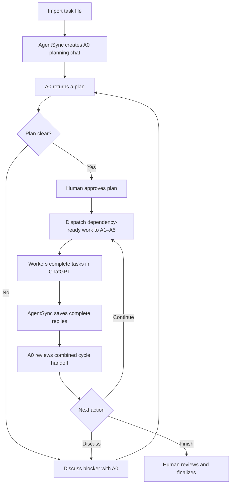

# AgentSync Workflow Guide

> Living guide for the current AgentSync workflow and sidebar. Update this file in the same change whenever a workflow, tab, or primary action changes. Keep the diagrams aligned with the shipped UI.

## What AgentSync is

AgentSync is a local Chrome side-panel extension for coordinating development work across ChatGPT conversations. A0 is the supervisor. A1–A5 are worker roles. AgentSync stores task batches, chat links, prompts, reports, and events in the browser's local database. It does not use a remote AgentSync backend or the OpenAI API.

The repository also includes an optional Local MCP Test server and Chrome bridge. That is a separate local message/event path; it is not required for the standard AgentSync task workflow.

## Workflow at a glance

## How a task moves

1. Import a Markdown task file. AgentSync creates or resumes the matching batch and creates/registers an A0 planning chat.
2. A0 proposes a structured plan. Discuss blockers in the normal ChatGPT chat. Approve a clear plan explicitly in AgentSync.
3. AgentSync creates missing worker chats and dispatches only assignments whose prerequisites are satisfied. Each submitted assignment is tagged with its cycle.
4. The browser bridge observes registered ChatGPT chats. Once all assigned workers in a cycle are idle, AgentSync saves their complete final replies and sends one combined handoff to A0.
5. A0 may return validated status updates and next actions. AgentSync checks team, target, report IDs, and prerequisite order before accepting or dispatching.
6. If A0 returns a blocker or invalid response, the flow pauses for human discussion. Continue only after A0's next response is ready.
7. Review saved conversations and reports. Local finalization records a local state; it does not prove GitHub completion, issue closure, PR readiness, or merge eligibility.

## Sidebar and navigation

The side panel is narrow, so navigation uses icon-only tabs with hover/focus tooltips and accessible labels for screen readers. The active tab is visually distinct. Keep the current areas and add Timing Settings:

| Tab | Icon concept | Purpose |
|---|---|---|
| Workspace | grid/briefcase | Import tasks, manage batches, and run the guided workflow |
| History | clock/stack | Review saved chats, reports, executions, and events |
| Permissions | access/diamond | Review and request optional ChatGPT, GitHub API, clipboard, and active-tab access |\n| Settings | gear | Configure repository prompts, view local error logs, and manage local data |
| Timing Settings | clock sliders | Configure task timing and scheduling behavior |

Icons need descriptive tooltip text on hover and keyboard focus. Do not rely on color alone to indicate the active tab.

## Guided workflow layout

The Workspace has a compact step navigator at the top for Import, Approve plan, Monitor, and Work & review. Selecting a step jumps directly to that section so users do not have to search through the full page. Keep the main action controls grouped in the relevant step and gate them on their existing prerequisites. The navigator is a navigation aid; the underlying workspace remains a single page.

Suggested step order:

1. Import or resume a task batch.
2. Review A0's plan and blockers.
3. Approve the plan and start ready work.
4. Monitor the current worker cycle.
5. Review A0's handoff and continue, discuss, or finalize.

The history and detailed records can remain below the guided action area. Do not duplicate lifecycle controls across multiple distant sections.

## Timing Settings

Timing Settings is a dedicated tab for timing-related preferences. Keep its controls separate from general permissions and repository configuration. Explain each setting in plain language and show whether it affects new work, active work, or both.

### Future update note

When implementing or changing task timing, record the timing choice and relevant timestamps in the persisted execution/batch history. Use those records to make scheduling more dynamic in a later update—for example, adapting dispatch timing from observed task durations and worker availability. Do not silently change current scheduling behavior until that later behavior is designed and exposed to the user.

## Permission guidance

Request optional browser permissions only when the related feature is first used, and explain the feature before the Chrome prompt. Keep permission status visible in Settings. The interface should use icons where space is limited, with tooltips that explain each control.

## Safety and expected behavior

- Human approval is required to accept an A0 plan and finalize a team.
- Do not retry an ambiguous ChatGPT handoff automatically. Ask the user to reconcile whether it was sent.
- Cancel only unsent orders. Pause a batch to block new dispatches.
- The browser bridge reads rendered state only from registered chats. ChatGPT page changes can break selectors or handoffs.
- GitHub read and write operations have separate permissions. Review generated context before sharing it with A0.
- No automatic merge, issue closure, or claim of verified completion follows from local finalization.

## Keeping this guide current

Update this file in the same pull request as any change to:
- navigation tabs, icons, permissions, or primary actions;
- task import, plan approval, dispatch, cycle handoff, recovery, pause, or finalization;
- timing settings or the data recorded for timing;
- Local MCP setup or the boundary between AgentSync and the optional MCP test plugin.

When a behavior is not implemented yet, label it as a proposal or future update instead of describing it as available.
